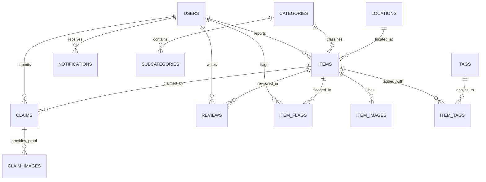

# ReClaim Database & DBMS Design Specification

**Course:** Database Management System | DBMS-V-T078  
**Team:** SyntaxScholars  
**Institution:** Graphic Era University (GEU), Dehradun Campus  
**Database Engine:** Supabase PostgreSQL with PostGIS Spatial Extension & pgcrypto  

---

## 1. Relational Architecture (Fourteen Interrelated Tables)

The database schema is fully normalized to Third Normal Form (3NF) and consists of fourteen interrelated tables maintaining strict referential integrity, constraints, and auditability:

1. **`auth.users`**: Master authentication authority (Supabase Auth). Stores user credentials, encrypted bcrypt password hashes, and session validity.
2. **`public.users`**: Application user profiles linked to `auth.users(id)` via UUID `ON DELETE CASCADE`. Stores name, email, role (`admin`, `finder`, `user`), contact information, verification state, activation status, and moderation blacklisting status.
3. **`public.categories`**: Controlled item category hierarchy (e.g. Electronics, Clothing, Accessories, Documents, Books, Others).
4. **`public.subcategories`**: Granular classifications linked to parent categories with `ON DELETE CASCADE`.
5. **`public.locations`**: University campus facilities (buildings, floors, rooms) storing WGS84 spatial coordinates using PostGIS `geometry(point, 4326)`.
6. **`public.items`**: Central entity capturing lost and found belongings with lifecycle states (`reported`, `matched`, `claimed`, `returned`, `closed`), specific locations, PostGIS coordinates, identifying attributes (color, brand, model, serial number), reward, urgency, and moderation flags.
7. **`public.item_images`**: Multi-image storage supporting primary thumbnail assignment with `ON DELETE CASCADE`.
8. **`public.tags`**: Controlled keyword tags for flexible categorization and search discovery.
9. **`public.item_tags`**: Many-to-many junction table associating items with keyword tags.
10. **`public.claims`**: Ownership claims submitted by students with proof descriptions, contact details, review statuses (`pending`, `approved`, `rejected`, `withdrawn`), and reviewer audit metadata.
11. **`public.claim_images`**: Supporting photographic proof attachments uploaded with claims.
12. **`public.notifications`**: Real-time and in-app alert queue for candidate matches, claim status updates, and system notices.
13. **`public.reviews`**: Post-recovery community feedback and 1-5 star ratings for returned items, fostering campus trust.
14. **`public.item_flags`**: Administrative moderation queue capturing suspicious or fraudulent item reports with reason and moderator resolution notes.

Plus audit trail support via **`public.audit_logs`** tracking all state mutations (actor, action, table, record ID, diffs, IP address).

---

## 2. Entity-Relationship Diagram (ERD)



---

## 3. DBMS Invariants & Automated Triggers

### 3.1 Self-Claim Prevention Trigger
Enforces the business rule that a user cannot submit a claim for an item they reported:
```sql
CREATE OR REPLACE FUNCTION public.prevent_self_claim()
RETURNS trigger AS $$
BEGIN
  IF EXISTS (
    SELECT 1 FROM public.items
    WHERE id = NEW.item_id AND reported_by = NEW.claimer_id
  ) THEN
    RAISE EXCEPTION 'An item reporter cannot claim their own item';
  END IF;
  RETURN NEW;
END;
$$ LANGUAGE plpgsql;

CREATE TRIGGER claims_prevent_self_claim
BEFORE INSERT OR UPDATE ON public.claims
FOR EACH ROW EXECUTE FUNCTION public.prevent_self_claim();
```

### 3.2 Role Escalation Protection
Prevents non-admin accounts from elevating their permissions:
```sql
CREATE OR REPLACE FUNCTION public.enforce_user_role_security()
RETURNS trigger AS $$
BEGIN
  IF (OLD.role IS DISTINCT FROM NEW.role) THEN
    IF auth.uid() IS NOT NULL THEN
      IF NOT EXISTS (
        SELECT 1 FROM public.users
        WHERE id = auth.uid() AND role = 'admin' AND is_active = true
      ) THEN
        RAISE EXCEPTION 'Permission denied: only administrators can change user roles';
      END IF;
    END IF;
  END IF;
  RETURN NEW;
END;
$$ LANGUAGE plpgsql;
```

### 3.3 Multi-Criteria Matching Engine
Calculates compatibility between opposite report types (lost vs found):
$$\text{Score} = w_{\text{category}} \cdot \mathbb{I}_{\text{same\_cat}} + w_{\text{color}} \cdot \mathbb{I}_{\text{same\_color}} + w_{\text{loc}} \cdot \mathbb{I}_{\text{same\_loc}} + w_{\text{time}} \cdot \mathbb{I}_{\Delta t < 24\text{h}}$$
Where $w_{\text{category}} = 0.45$, $w_{\text{color}} = 0.25$, $w_{\text{loc}} = 0.20$, and $w_{\text{time}} = 0.10$.
Matches scoring $\ge 0.55$ automatically dispatch notifications to both item reporters.

### 3.4 Spatial Indexing (PostGIS)
PostGIS R-Tree GiST indexes accelerate location-based spatial queries:
```sql
CREATE INDEX items_coordinates_idx ON public.items USING gist (coordinates);
CREATE INDEX locations_coordinates_idx ON public.locations USING gist (coordinates);
```

---

## 4. Normalization Audit (3NF)

- **1NF**: All table columns are atomic; multi-valued tags and media are decomposed into `item_tags` and `item_images`.
- **2NF**: All non-key attributes fully functionally depend on the complete primary key. Junction tables (`item_tags`) use compound keys `(item_id, tag_id)`.
- **3NF**: There are no transitive dependencies; location details (building, floor, coordinates) are decoupled into `locations`, referenced by `location_id`.
